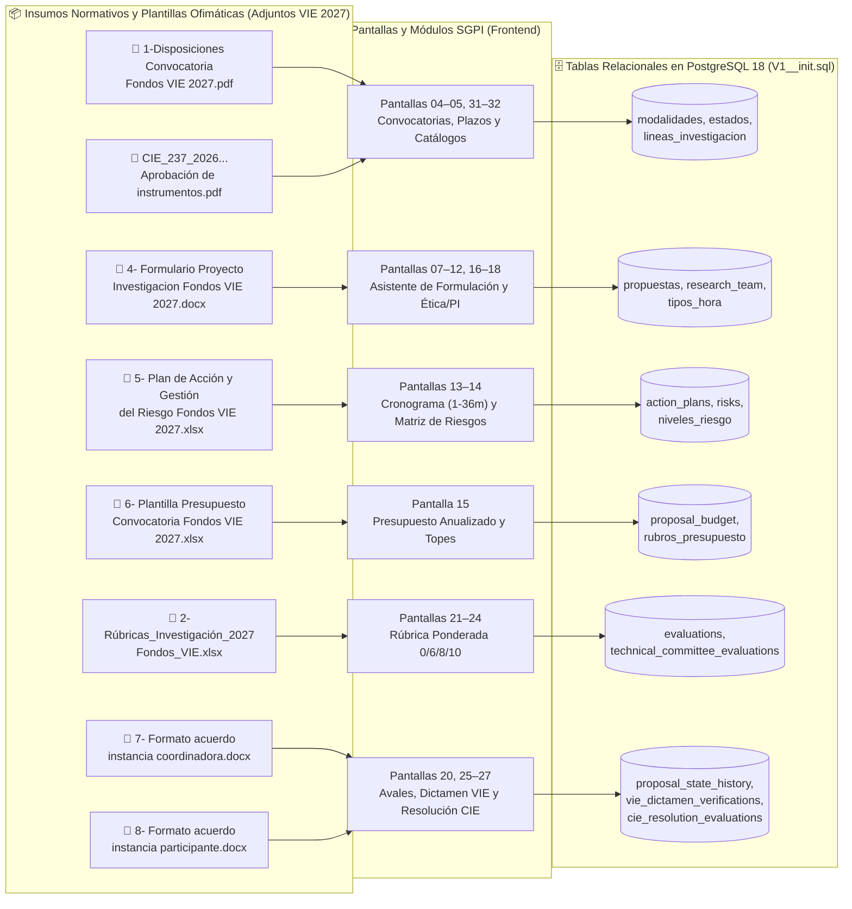
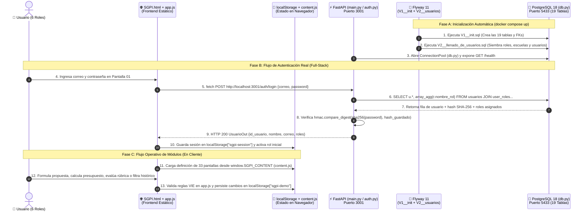
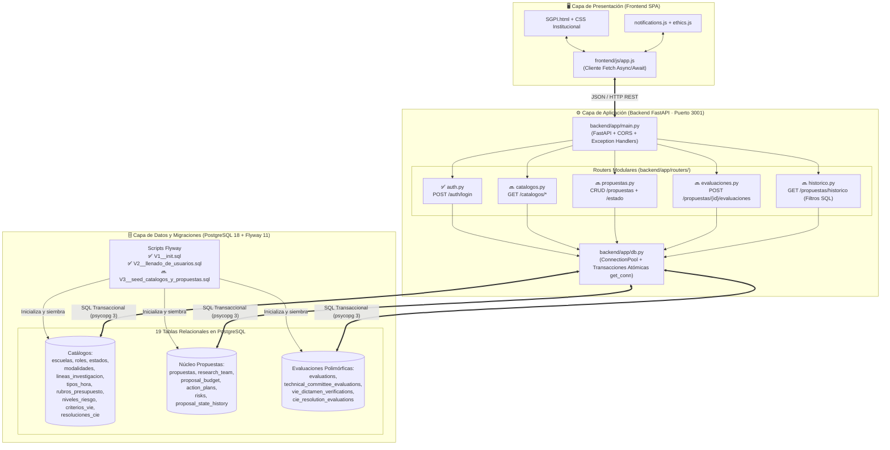
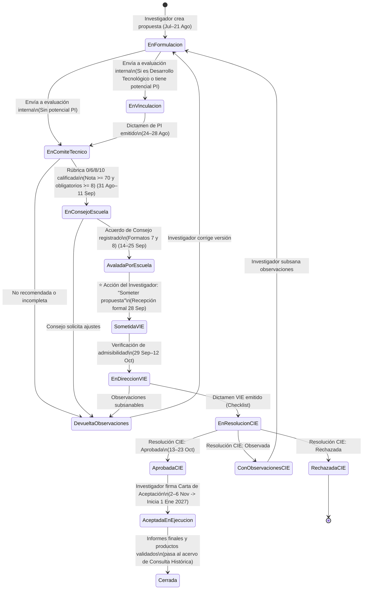
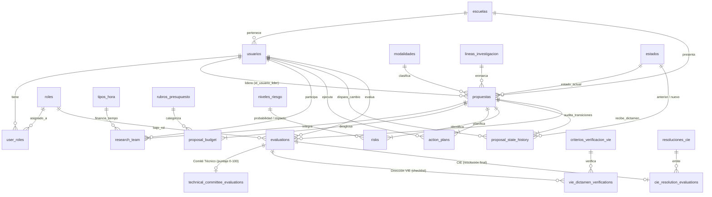

<div align="center">

# 🏛️ SGPI · VIE — Sistema para la Gestión de Propuestas de Investigación
### Convocatoria Fondos VIE 2027 · Instituto Tecnológico de Costa Rica (TEC)
**Escuela de Ingeniería en Computación · Curso: Diseño de Software**


</div>

---

## 📌 Descripción General

El **Sistema para la Gestión de Propuestas de Investigación (SGPI)** es una plataforma diseñada para digitalizar, automatizar y dar trazabilidad de extremo a extremo al ciclo de vida de las iniciativas de investigación del **Instituto Tecnológico de Costa Rica (TEC)** bajo la normativa oficial de la convocatoria **Fondos VIE 2027** (aprobada en sesión extraordinaria del CIE mediante acuerdo `CIE-237-2026`).

El proyecto transforma un proceso tradicionalmente fragmentado en múltiples documentos ofimáticos independientes (`.docx`, `.xlsx`, `.pdf`) en un **expediente digital único** estructurado en tres módulos principales:
1. 📝 **Módulo de Formulación y Redacción:** Captura estructurada de propuestas en 11 pasos con validación normativa en tiempo real (horas por investigador, topes presupuestarios por modalidad, plan de acción, matriz de riesgos, ética y propiedad intelectual).
2. ⚖️ **Módulo de Evaluación y Avales Multi-Instancia:** Revisión secuencial y diferenciada según el rol institucional (**Centro de Vinculación**, **Comité Técnico**, **Consejo de Escuela**, **Dirección de Investigación / VIE** y **Consejo de Investigación y Extensión / CIE**).
3. 🗂️ **Módulo de Consulta Histórica y Trazabilidad:** Buscador facetado con filtros combinados (escuela, persona investigadora, línea de investigación, modalidad y estatus) y bitácora auditable de cada transición de estado.

---

## 🎯 Hoja de Ruta Académica (Las 4 Etapas del Proyecto)

| Etapa | Enfoque Metodológico | Entregables Clave en el Proyecto | Estado |
| :--- | :--- | :--- | :---: |
| **Etapa 1**<br>*Arquitectura de Información* | Análisis profundo de *Disposiciones Fondos VIE 2027*, perfiles (*user personas*), *user journeys* y mapa del sitio. | Reglas de negocio, matriz de roles y trazabilidad en [`REQUISITOS_Y_TRAZABILIDAD.md`](./frontend/md/REQUISITOS_Y_TRAZABILIDAD.md). | ✅ Completado |
| **Etapa 2**<br>*Diseño de Interfaz (UI/UX)* | Wireframes, guía de estilos institucional (`#002855`, `#EF3340`, `#FFFFFF`) y prototipo interactivo de 33 pantallas. | Prototipo navegable en [`frontend/`](./frontend/html/SGPI.html), catálogo en [`CATALOGO.md`](./frontend/md/CATALOGO.md) y plugin [`figma-import/`](./figma-import/). | ✅ Completado |
| **Etapa 3**<br>*Base de Datos y Arquitectura* | Modelo Entidad-Relación (MER) normalizado (19 tablas), diccionario de datos y contenedorización. | Esquema DDL en [`V1__init.sql`](./Base%20de%20datos/Scripts/V1__init.sql), diccionario en [`diseño.md`](./Base%20de%20datos/Markdowns/diseño.md) y diagramas en [`Diagrama/`](./Base%20de%20datos/Diagrama/). | ✅ Completado |
| **Etapa 4**<br>*Prototipo Funcional Full-Stack* | Integración Frontend + Backend REST + PostgreSQL con datos semilla (*seed data*) para demostrar el flujo completo. | Orquestación en [`docker-compose.yml`](./docker-compose.yml), login real en [`auth.py`](./backend/app/routers/auth.py) y evolución de routers REST. | 🔄 En transición |

---

## 📄➡️🗄️ De los Archivos Institucionales (Adjuntos) al Modelo de Datos del SGPI

Tradicionalmente, postular y evaluar un proyecto en la convocatoria **Fondos VIE 2027** requería descargar, llenar manualmente y enviar por correo o gestores documentales **8 archivos independientes**. El SGPI reemplaza ese flujo de archivos dispersos por estructuras de datos relacionales y validaciones automatizadas:



### Tabla de Transformación: Archivos Originales vs. Digitalización en SGPI

| Archivo Oficial (Adjunto) | Función en el Proceso Manual | Transformación en el Flujo de Datos del SGPI | Tablas Destino en PostgreSQL |
| :--- | :--- | :--- | :--- |
| **`1-Disposiciones Convocatoria Fondos VIE 2027.pdf`** y **`CIE_237_2026...pdf`** | Define reglas en texto estático: modalidades, topes (₡2M, ₡4M/año, ₡5M/año), tipos de hora y fechas límite. | Se codifica como **reglas de validación activas** en UI/API, máquina de estados y catálogos cerrados. | `modalidades`, `estados`, `tipos_hora`, `lineas_investigacion` |
| **`4- Formulario Proyecto Investigacion Fondos VIE 2027.docx`** | Documento Word extenso para redactar datos generales, equipo, horas, problema, estado del arte, objetivos, metodología, TRL/PI y ética. | Se desglosa en un **asistente interactivo de 11 pasos** (Pantallas `08` a `18`) que valida campos obligatorios, horas mínimas ($\ge 4\text{ h}$) y declaraciones éticas. | `propuestas`, `research_team`, `tipos_hora`, `usuarios`, `escuelas` |
| **`5- Plan de Acción y Gestión del Riesgo Fondos VIE 2027.xlsx`** | Libro Excel (`Plan de Acción-Riesgos!B16:K16`) donde se ligan objetivos, actividades, meses (1–36), responsables y al menos 1 riesgo por actividad. | Vistas estructuradas en **Pantalla 13 (Plan de acción)** y **Pantalla 14 (Gestión de riesgos)** con vínculo directo a los miembros del equipo investigador. | `action_plans`, `risks`, `niveles_riesgo` |
| **`6- Plantilla Presupuesto Convocatoria Fondos VIE 2027.xlsx`** | Hojas separadas (`2027`, `2028`, `2029`) por objeto de gasto (servicios, suministros, beca asistente 10h/sem a ₡2.400/h, equipo solo Año 1). | **Calculadora presupuestaria reactiva (Pantalla 15)** que suma rubros con `SUM()`, verifica topes anuales y bloquea el envío si se excede el límite de la modalidad. | `proposal_budget`, `rubros_presupuesto` |
| **`2-Rúbricas_Investigación_2027__Fondos_VIE.xlsx`** | 3 hojas de Excel con pesos por sección, escala `0 / 6 / 8 / 10` y celda `A7` de bloqueo por criterios obligatorios o productos incumplidos. | **Evaluador interactivo del Comité Técnico (Pantalla 24)** que calcula automáticamente el puntaje ponderado ($0\text{–}100$) e impide recomendar si un criterio obligatorio es *Regular (6)* o *Deficiente (0)*. | `evaluations`, `technical_committee_evaluations` |
| **`7- Formato de acuerdo instancia coordinadora...docx`** y **`8- ...participante.docx`** | Oficios Word firmados por Consejos de Escuela ratificando nota técnica, horas aprobadas y presupuesto. | **Registro digital de Aval de Consejo (Pantalla 25)** que habilita al investigador el botón **«Someter propuesta»** (Pantalla 20), seguido del checklist VIE (Pantalla 26) y fallo CIE (Pantalla 27). | `proposal_state_history`, `vie_dictamen_verifications`, `cie_resolution_evaluations` |

---

## 📂 Estructura de Archivos del Repositorio

```text
SGPI/
├── docker-compose.yml                  # Orquestador de contenedores: PostgreSQL 18 + Flyway 11 + FastAPI
├── README.md                           # Documentación arquitectónica y guía de flujo de archivos y datos
│
├── Base de datos/                      # Capa de Persistencia y Diseño de Datos (Etapa 3)
│   ├── Scripts/
│   │   ├── V1__init.sql                # Migración Flyway V1: DDL de las 19 tablas normalizadas y FKs
│   │   └── V2__llenado_de_usuarios.sql # Migración Flyway V2: Seed de 6 roles, 2 escuelas y 9 usuarios (SHA-256)
│   ├── Markdowns/
│   │   └── diseño.md                   # Diccionario de datos detallado (tipos, PKs, FKs, nulabilidad)
│   ├── Cambios.md                      # Justificación técnica de normalización y desglose de tablas
│   └── Diagrama/                       # Diagramas MER y Relacional en alta resolución (.png y .svg)
│
├── backend/                            # Capa de Servicios y Lógica de Negocio (API REST en FastAPI)
│   ├── Dockerfile                      # Imagen Python 3.12-slim que expone Uvicorn en el puerto 3000 (host 3001)
│   ├── requirements.txt                # Dependencias: fastapi, uvicorn[standard], psycopg[binary,pool]
│   └── app/
│       ├── main.py                     # Punto de entrada FastAPI, CORS, lifespan del pool, /health y manejo de errores SQL
│       ├── db.py                       # Pool de conexiones PostgreSQL (psycopg_pool) y dependencia transaccional get_conn()
│       └── routers/
│           └── auth.py                 # Endpoint activo POST /auth/login (validación SHA-256 + hmac.compare_digest)
│           # Próximos routers (Etapa 4): catalogos.py, propuestas.py, evaluaciones.py, historico.py
│
├── frontend/                           # Capa de Presentación e Interacción (33 Pantallas SPA Vanilla JS)
│   ├── html/
│   │   ├── SGPI.html                   # Aplicación principal interactiva (punto de entrada del usuario)
│   │   ├── catalogo.html               # Índice navegable de las 33 pantallas base del sistema
│   │   └── example.html                # Versión autocontenida de respaldo
│   ├── css/
│   │   ├── base.css                    # Sistema de diseño layout, grillas, tablas, formularios y componentes
│   │   ├── branding.css                # Paleta institucional TEC (#002855, #EF3340, #FFFFFF) y tipografía Roboto
│   │   ├── usability.css               # Mejoras de accesibilidad, estados de foco y microinteracciones
│   │   └── notifications.css           # Estilos del centro de notificaciones y menús desplegables
│   ├── js/
│   │   ├── content.js                  # Catálogo estructurado (window.SGPI_CONTENT) de las 33 pantallas y campos base
│   │   ├── app.js                      # Motor SPA: cliente HTTP (/auth/login), estado, validaciones, rúbrica y ruteo
│   │   ├── ethics.js                   # Observador DOM para estandarización de etiquetas de declaraciones éticas
│   │   └── notifications.js            # Gestión de notificaciones por rol (filtros Todas, Sin leer, Trámites, Convocatorias)
│   └── md/
│       ├── GUIA_ENTREGA.md             # Guía de recorridos de demostración por rol y estado del prototipo
│       ├── REQUISITOS_Y_TRAZABILIDAD.md# Trazabilidad exhaustiva contra los documentos de Fondos VIE 2027
│       ├── CATALOGO.md                 # Listado de las 33 pantallas base
│       └── VALIDACION.md               # Alcance de las pruebas de validación documental y de navegación
│
└── figma-import/                       # Empaquetado del plugin local para importación de capas y flujos en Figma
```

---

## 🔄 Flujo Actual vs. Flujo Futuro de Archivos y Datos

> [!IMPORTANT]
> El proyecto se encuentra actualmente en una **arquitectura híbrida funcional**: la infraestructura de contenedores, el esquema completo de base de datos (19 tablas) y la **autenticación institucional por roles (`POST /auth/login`)** operan de extremo a extremo contra **PostgreSQL 18**, mientras que la persistencia de los formularios de propuestas, evaluaciones e histórico opera en el cliente (`localStorage` + `content.js`) lista para conectarse a los routers REST de `catalogos` y `propuestas` previstos en [`backend/app/main.py`](./backend/app/main.py).

---

### 1️⃣ Flujo Actual de Archivos y Datos (Arquitectura Híbrida Actual)

En el estado actual del repositorio, los archivos y datos fluyen en tres fases bien definidas:



#### Detalle de cómo interactúan los archivos hoy:
1. **Orquestación y Base de Datos (`docker-compose.yml` $\rightarrow$ `Base de datos/Scripts/`):**
   * Al levantar Docker, el contenedor `sgpi-db` inicia **PostgreSQL 18**.
   * Una vez que el *healthcheck* (`pg_isready`) responde positivamente, el contenedor `sgpi-flyway` monta en modo solo lectura `./Base de datos/Scripts:/flyway/sql:ro` y ejecuta en orden:
     * [`V1__init.sql`](./Base%20de%20datos/Scripts/V1__init.sql): Construye las **19 tablas relacionales** (catálogos, usuarios, propuestas, equipo, presupuesto, plan de acción, riesgos, historial y las 3 especializaciones de evaluación).
     * [`V2__llenado_de_usuarios.sql`](./Base%20de%20datos/Scripts/V2__llenado_de_usuarios.sql): Inserta los **6 roles oficiales**, **2 escuelas** (`IAMB`, `IELE`) y **9 usuarios** con contraseñas cifradas en hexadecimal mediante `encode(sha256('demostracion'::bytea), 'hex')`.
2. **Conexión Backend (`backend/app/db.py` $\rightarrow$ `backend/app/main.py` $\rightarrow$ `backend/app/routers/auth.py`):**
   * [`db.py`](./backend/app/db.py) administra un `ConnectionPool` (`min_size=1`, `max_size=10`, `row_factory=dict_row`) conectado mediante `DATABASE_URL`.
   * [`main.py`](./backend/app/main.py) gestiona el ciclo de vida del pool (`lifespan`), habilita `CORSMiddleware`, expone `GET /health` y registra traductores automáticos de excepciones de PostgreSQL (`ForeignKeyViolation` $\rightarrow$ `400`, `UniqueViolation` $\rightarrow$ `409`, `NotNullViolation` $\rightarrow$ `400`).
   * [`auth.py`](./backend/app/routers/auth.py) expone `POST /auth/login`, consulta de forma segura al usuario y sus roles, compara el hash en tiempo constante (`hmac.compare_digest`) y rechaza cuentas inactivas (`estado_activo = false`).
3. **Ejecución en el Frontend (`frontend/html/SGPI.html` $\rightarrow$ `frontend/js/`):**
   * [`SGPI.html`](./frontend/html/SGPI.html) ensambla las 4 hojas de estilo (`base.css`, `usability.css`, `branding.css`, `notifications.css`) y los 4 scripts (`content.js`, `app.js`, `ethics.js`, `notifications.js`).
   * [`app.js`](./frontend/js/app.js) consume `POST http://localhost:3001/auth/login` mediante `apiLogin()`. Una vez autenticado el usuario, mapea el rol devuelto por la base de datos (`ROLE_KEYS`) y sincroniza el estado del expediente demostrativo (**SI-2027-014 · Agua Inteligente: monitoreo de cuencas**) e histórico (**SI-2024-008**) en `localStorage["sgpi-demo"]`.

---

### 2️⃣ Flujo Futuro de Archivos y Datos (Arquitectura Full-Stack Integrada — Meta Etapa 4)

De acuerdo con los requerimientos de la **Etapa 4 (Prototipo Funcional)** del documento del curso y la estructura ya preparada en [`backend/app/main.py`](./backend/app/main.py) (líneas 9–10 y 25–26: `# from .routers import catalogos, propuestas`), el flujo evolucionará para que **todas las operaciones de lectura, escritura, evaluación y filtrado histórico viajen hacia PostgreSQL**:



#### Nuevos Archivos y Flujos de Datos en la Arquitectura Futura:

1. **Nuevo Script de Datos Semilla (`Base de datos/Scripts/V3__seed_catalogos_y_propuestas.sql`):**
   * Poblará automáticamente al iniciar Docker todos los catálogos normativos de **Fondos VIE 2027**:
     * `estados`: *En formulación*, *En revisión de Vinculación*, *En evaluación del Comité Técnico*, *Pendiente de aval del Consejo*, *Avalada*, *Sometida ante VIE*, *Dictaminada por Dirección*, *Aprobada por CIE*, *Con observaciones*, *Rechazada*, *En ejecución*, *Cerrada*.
     * `modalidades`: *Actividad de fortalecimiento*, *Investigación básica, aplicada o ambas*, *Desarrollo tecnológico*.
     * `tipos_hora`: `VIE`, `VIE-Centros`, `CONS`, `REC`, `DOC`, `VIESA`.
     * `rubros_presupuesto`: Servicios, Materiales y suministros, Becas estudiante asistente especial, Equipo y bienes duraderos, Viáticos dentro del país.
     * `criterios_verificacion_vie` y `resoluciones_cie`: Criterios booleanos del checklist de Dirección de Investigación y resoluciones (`Aprobada`, `Rechazada`, `Observada`).
   * Insertará propuestas históricas realistas de distintas escuelas, investigadores, líneas y estados finales (como `SI-2027-014` y `SI-2024-008`) para alimentar el módulo de **Consulta Histórica**.

2. **Expansión de Routers en el Backend (`backend/app/routers/`):**
   * **`catalogos.py` (`GET /catalogos`):** Entrega en una sola carga o por recurso las listas de `escuelas`, `modalidades`, `lineas_investigacion`, `tipos_hora`, `rubros_presupuesto`, `niveles_riesgo`, `criterios_verificacion_vie` y `resoluciones_cie` para poblar los `<select>` del frontend sin datos quemados.
   * **`propuestas.py` (`GET /propuestas`, `POST /propuestas`, `PUT /propuestas/{id}`, `PATCH /propuestas/{id}/estado`):**
     * Recibe los pasos del formulario de redacción y ejecuta inserciones transaccionales (gracias al `with pool.connection() as conn:` de [`db.py`](./backend/app/db.py)) sobre `propuestas`, `research_team`, `action_plans`, `risks` y `proposal_budget`.
     * Cada cambio de etapa (enviar a revisión, emitir aval, someter formalmente a VIE, resolver en CIE) actualiza `propuestas.estado_actual` e inserta simultáneamente un registro inmutable en `proposal_state_history` con `id_estado_anterior`, `id_estado_nuevo`, `id_usuario_responsable`, `fecha_cambio` y `observaciones`.
   * **`evaluaciones.py` (`POST /propuestas/{id}/evaluaciones`):**
     * Registra la cabecera común en `evaluations` (`id_propuesta`, `id_usuario_eval`, `id_rol_evaluador`, `fecha_evaluacion`, `observaciones`) y, según el rol del evaluador, escribe el detalle especializado en:
       * `technical_committee_evaluations` (puntaje numérico $0\text{–}100$ calculado con la rúbrica).
       * `vie_dictamen_verifications` ($N$ filas booleanas `(id_evaluacion, id_criterio, cumple)`).
       * `cie_resolution_evaluations` (vínculo con `id_resolucion`: *Aprobada*, *Rechazada* u *Observada*).
   * **`historico.py` (o filtros en `GET /propuestas`):**
     * Ejecuta consultas parametrizadas con `JOIN` y cláusulas `WHERE` dinámicas para filtrar simultáneamente por **Escuela** (`id_escuela`), **Persona Investigadora** (`id_usuario_lider` o integrante en `research_team`), **Línea de Investigación** (`id_linea_investigacion`), **Modalidad** (`id_modalidad`), **Estatus** (`estado_actual`) y búsqueda textual en `titulo`/`resumen`.

---

### 3️⃣ Comparativa Sintética: Flujo Actual vs. Flujo Futuro

| Dimensión / Módulo | 🟡 Flujo Actual (Prototipo Híbrido) | 🟢 Flujo Futuro (Prototipo Full-Stack Etapa 4) |
| :--- | :--- | :--- |
| **Inicialización de Datos** | Flyway ejecuta `V1__init.sql` (esquema de 19 tablas) y `V2__llenado_de_usuarios.sql` (roles, escuelas, usuarios). | Se añade `V3__seed_catalogos_y_propuestas.sql` con catálogos VIE 2027 completos y expedientes semilla históricos. |
| **Autenticación y Roles** | **100% Real:** `app.js` $\rightarrow$ `POST /auth/login` (`auth.py`) $\rightarrow$ PostgreSQL (`usuarios`, `user_roles`). Sesión en `localStorage["sgpi-session"]`. | Se mantiene el flujo contra PostgreSQL y se incorpora envío de encabezado de sesión/identidad en los endpoints de escritura para auditoría en `proposal_state_history`. |
| **Catálogos Institucionales** | Definidos localmente en estructuras JavaScript (`content.js` y `app.js`). | Servidos dinámicamente desde PostgreSQL vía `GET /catalogos` (`backend/app/routers/catalogos.py`). |
| **Formulación (Pantallas 07–19)** | Edición interactiva de los 11 pasos con validaciones normativas en `app.js` y guardado en `localStorage["sgpi-demo"]`. | Guardado transaccional vía `POST /propuestas` y `PUT /propuestas/{id}` en `propuestas`, `research_team`, `proposal_budget`, `action_plans` y `risks`. |
| **Evaluación Multi-Actor (Pantallas 21–27)** | Simulación interactiva de rúbrica, aval de consejo, dictamen VIE y fallo CIE en memoria del navegador. | Persistencia relacional vía `POST /propuestas/{id}/evaluaciones` en `evaluations` y sus 3 tablas hijas (`technical_committee_evaluations`, `vie_dictamen_verifications`, `cie_resolution_evaluations`). |
| **Trazabilidad de Estados (Pantalla 20 y 28)** | Cambio de estado reflejado en el objeto `state` del cliente. | Cada transición dispara una transacción atómica que actualiza `propuestas.estado_actual` y añade una fila auditable en `proposal_state_history`. |
| **Consulta Histórica (Pantallas 29–30)** | Filtrado en memoria sobre el arreglo de expedientes demostrativos en `app.js`. | Consultas SQL combinadas en PostgreSQL (`GET /propuestas?id_escuela=...&id_linea=...&id_estado=...`) con agregación de presupuesto `SUM(monto)`. |

---

## 🏛️ Ciclo de Vida Institucional de una Propuesta (Flujo de Estados y Roles)

Siguiendo estrictamente las **Disposiciones de la Convocatoria Fondos VIE 2027**, el flujo de datos de una propuesta **no salta directamente del Investigador a la Dirección de Investigación**, ni el aval de escuela equivale al sometimiento formal:



### Reglas de Negocio Críticas en el Flujo de Datos
* **Distinción entre *Enviar a evaluación* y *Someter propuesta*:** Cuando el investigador termina de redactar (Pantalla 18), envía la propuesta a las instancias internas (Vinculación $\rightarrow$ Comité Técnico $\rightarrow$ Consejo de Escuela). Una vez que el Consejo emite el **Aval** (Pantalla 25), el expediente regresa a la bandeja del investigador en estado **Avalada** (Pantalla 20), donde el investigador debe pulsar explícitamente **«Someter propuesta»** (con fecha límite **28 de septiembre**) para elevarla formalmente a la Dirección de Investigación (VIE).
* **Reglas Numéricas por Modalidad:**
  * **Actividad de fortalecimiento:** Máx. 1 año · Tope **₡2.000.000** total · Equipo máx. $8\text{ h/sem}$ (al menos $4\text{ h}$ `VIE`/`VIE-Centros`/`CONS`, cada investigador $\ge 4\text{ h}$).
  * **Investigación básica, aplicada o ambas:** Máx. 2 años · Tope **₡4.000.000/año** · Proyecto mín. $8\text{ h/sem}$ `VIE`/`VIE-Centros`/`CONS` (cada investigador $\ge 4\text{ h}$, o `REC` $\ge 2\text{ h}$) · Beca asistente especial mín. $10\text{ h/sem}$ a **₡2.400/h** (hasta 10 meses/año).
  * **Desarrollo tecnológico:** Máx. 3 años · Tope **₡5.000.000/año** · Dictamen de Vinculación obligatorio · Al menos **1 activo de Propiedad Intelectual (PI)** + opciones académicas según horas totales.
* **Bloqueo Automático en Rúbrica del Comité Técnico:** Cada criterio se califica como **Deficiente (0)**, **Regular (6)**, **Bueno (8)** o **Excelente (10)**. Aunque el promedio ponderado alcance o supere **70/100**, si **cualquier criterio marcado como obligatorio** recibe calificación *Regular (6)* o *Deficiente (0)*, el sistema bloquea la recomendación favorable.

---

## 🗄️ Modelo Relacional de Base de Datos (19 Tablas en PostgreSQL 18)

El diseño de base de datos en [`Base de datos/Scripts/V1__init.sql`](./Base%20de%20datos/Scripts/V1__init.sql) y documentado en [`Base de datos/Markdowns/diseño.md`](./Base%20de%20datos/Markdowns/diseño.md) está completamente normalizado: evita columnas de texto libre mediante **10 tablas de catálogo**, modela relaciones muchos-a-muchos con atributos propios (`research_team`, `proposal_budget`) y resuelve la heterogeneidad de las evaluaciones mediante una **jerarquía de supertipo/subtipo** (`evaluations` como tabla base y 3 tablas especializadas según la instancia evaluadora).

> 💡 *Los diagramas gráficos completos en formato `.png` y `.svg` se encuentran en [`Base de datos/Diagrama/`](./Base%20de%20datos/Diagrama/).*



---

## 🚀 Guía de Ejecución y Despliegue Local

### Prerrequisitos
* **Docker Desktop** (para levantar PostgreSQL 18, Flyway 11 y el Backend FastAPI).
* **Python 3.x** (o cualquier servidor HTTP estático como *VS Code Live Server* para servir el Frontend).

### Paso 1: Levantar Base de Datos, Migraciones y Backend
Abre una terminal en la raíz del proyecto (`c:\Proyecto-Diseño\SGPI`) y ejecuta:

```powershell
docker compose up --build
```
*(Puedes añadir `-d` si deseas ejecutarlo en segundo plano: `docker compose up -d --build`).*

Con este único comando se ejecutan en cadena:
1. **`sgpi-db` (PostgreSQL 18):** Expuesto en `localhost:5433` (base de datos `sgpi`, usuario `sgpi`, contraseña `sgpi_dev`).
2. **`sgpi-flyway` (Flyway 11):** Espera a que `sgpi-db` esté saludable y ejecuta automáticamente `V1__init.sql` y `V2__llenado_de_usuarios.sql`.
3. **`sgpi-backend` (FastAPI / Uvicorn):** Compila `./backend` y expone la API REST en **`http://localhost:3001`**.

🔍 **Verificación rápida del Backend:**
* **Healthcheck de API y BD:** [http://localhost:3001/health](http://localhost:3001/health) $\rightarrow$ debe responder `{"status": "ok"}`.
* **Documentación interactiva OpenAPI (Swagger UI):** [http://localhost:3001/docs](http://localhost:3001/docs)

### Paso 2: Levantar el Frontend
Abre una **segunda terminal** en la raíz del proyecto y sirve la carpeta `frontend/`:

```powershell
python -m http.server 8080 --directory frontend
```

Luego abre en tu navegador:
👉 **[http://localhost:8080/html/SGPI.html](http://localhost:8080/html/SGPI.html)**
*(También puedes consultar el índice completo de las 33 pantallas en [http://localhost:8080/html/catalogo.html](http://localhost:8080/html/catalogo.html)).*

---

## 🔐 Credenciales de Prueba (Usuarios Semilla en Base de Datos)

Todos los usuarios fueron sembrados por Flyway mediante [`V2__llenado_de_usuarios.sql`](./Base%20de%20datos/Scripts/V2__llenado_de_usuarios.sql) y se validan en tiempo real contra PostgreSQL a través de `POST /auth/login`.

🔑 **Contraseña universal para todos los usuarios:** **`demostracion`**

| Rol Institucional | Nombre Completo | Correo Institucional | Escuela | Estado |
| :--- | :--- | :--- | :---: | :---: |
| 👩‍🔬 **Investigador** *(Caso principal)* | Laura Méndez Quesada | `laura.mendez@example.com` | `IAMB` | 🟢 Activo |
| 👨‍🔬 **Investigador** | Andrés Rojas Calderón | `andres.rojas@example.com` | `IELE` | 🟢 Activo |
| 👩‍🔬 **Investigador** | Sofía Vega Araya | `sofia.vega@example.com` | `IAMB` | 🟢 Activo |
| 🤝 **Vinculación** | Mariana Solís Jiménez | `mariana.solis@example.com` | — | 🟢 Activo |
| 📋 **Comité Técnico** | Gabriel Sánchez Mora | `gabriel.sanchez@example.com` | — | 🟢 Activo |
| 🏛️ **Consejo de Escuela** | Patricia Vargas Solano | `patricia.vargas@example.com` | `IAMB` | 🟢 Activo |
| 🔎 **Dirección de Investigación (VIE)** | Elena Chacón Brenes | `elena.chacon@example.com` | — | 🟢 Activo |
| ⚖️ **CIE** | Ricardo Mora Villalobos | `ricardo.mora@example.com` | — | 🟢 Activo |
| 🚫 *Usuario de prueba bloqueo* | Usuario Inactivo Prueba | `inactivo@example.com` | `IELE` | 🔴 Inactivo (`401`) |

---

## 🛠️ Comandos Útiles de Mantenimiento

```powershell
# Ver logs del backend o de las migraciones Flyway en tiempo real
docker compose logs -f backend
docker compose logs flyway

# Detener los contenedores conservando los datos de PostgreSQL
docker compose down

# Reiniciar la base de datos desde cero (elimina el volumen sgpi_pgdata y vuelve a correr Flyway)
docker compose down -v
docker compose up --build
```

