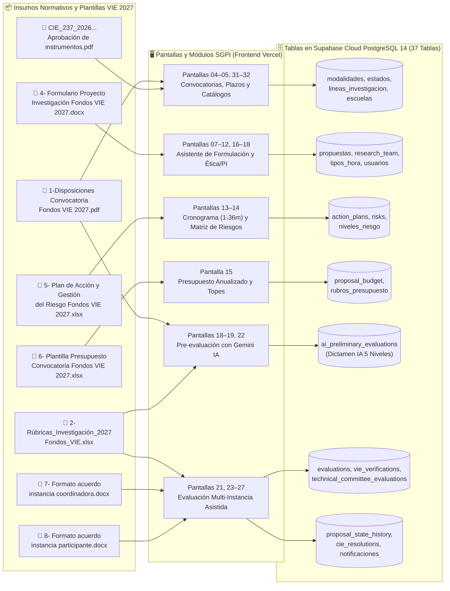
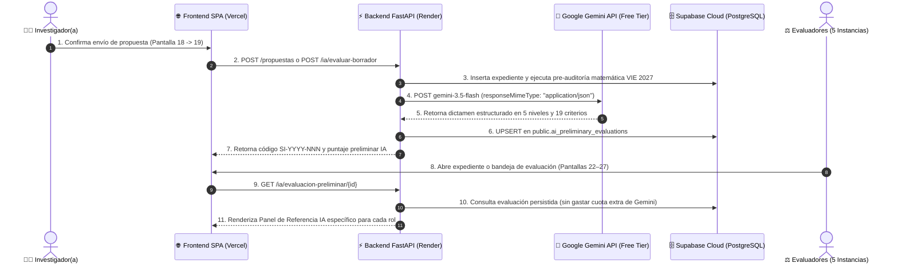

<div align="center">

# 🏛️ SGPI · VIE — Sistema para la Gestión de Propuestas de Investigación
### Convocatoria Fondos VIE 2027 · Instituto Tecnológico de Costa Rica (TEC)
**Escuela de Ingeniería en Computación · Curso: Diseño de Software**


-28a745?style=for-the-badge)

</div>

---

## 📌 Descripción General

El **Sistema para la Gestión de Propuestas de Investigación (SGPI)** es una plataforma digital full-stack diseñada para modernizar, automatizar y brindar trazabilidad de extremo a extremo al ciclo de vida de las iniciativas de investigación del **Instituto Tecnológico de Costa Rica (TEC)** bajo la normativa oficial de la convocatoria **Fondos VIE 2027** (Acuerdo del Consejo de Investigación y Extensión `CIE-237-2026`).

El proyecto transforma un proceso tradicionalmente fragmentado en múltiples documentos ofimáticos independientes (`.docx`, `.xlsx`, `.pdf`) en un **expediente digital único** estructurado en cuatro módulos principales:
1. 📝 **Módulo de Formulación y Redacción:** Captura estructurada de propuestas en 11 pasos con validación normativa activa (dedicación horaria $\ge 4\text{ h/sem}$ por investigador, topes presupuestarios por modalidad, cronograma mensualizado, matriz de riesgos ligada a actividades, ética y propiedad intelectual).
2. 🤖 **Módulo de Evaluación Preliminar con Google Gemini IA (Free Tier):** Generación automática y no vinculante de un dictamen técnico multinivel basado en los 19 criterios oficiales de la Rúbrica VIE 2027, topes presupuestarios y reglas de bloqueo cuando una propuesta es enviada a revisión.
3. ⚖️ **Módulo de Evaluación y Avales Multi-Instancia:** Revisión secuencial diferenciada según el rol institucional (**Centro de Vinculación**, **Comité Técnico**, **Consejo de Escuela**, **Dirección de Investigación / VIE** y **Consejo de Investigación y Extensión / CIE**).
4. 🗂️ **Módulo de Consulta Histórica y Trazabilidad:** Buscador facetado con filtros combinados (escuela, investigadora, línea de investigación, modalidad y estado) y bitácora inmutable de cada transición de estado en base de datos.

---

## 🎯 Hoja de Ruta Académica (Las 4 Etapas del Proyecto)

| Etapa | Enfoque Metodológico | Entregables Clave en el Proyecto | Estado |
| :--- | :--- | :--- | :---: |
| **Etapa 1**<br>*Arquitectura de Información* | Análisis profundo de *Disposiciones Fondos VIE 2027*, perfiles (*user personas*), *user journeys* y mapa del sitio. | Reglas de negocio, matriz de roles y trazabilidad en [`frontend/md/REQUISITOS_Y_TRAZABILIDAD.md`](./frontend/md/REQUISITOS_Y_TRAZABILIDAD.md). | ✅ Completado |
| **Etapa 2**<br>*Diseño de Interfaz (UI/UX)* | Wireframes, guía de estilos institucional (`#002855`, `#EF3340`, `#FFFFFF`) y prototipo navegable de 33 pantallas. | Prototipo interactivo en [`frontend/html/SGPI.html`](./frontend/html/SGPI.html), catálogo en [`frontend/md/CATALOGO.md`](./frontend/md/CATALOGO.md) y plugin [`figma-import/`](./figma-import/). | ✅ Completado |
| **Etapa 3**<br>*Base de Datos y Arquitectura* | Modelo Entidad-Relación normalizado (37 tablas), diccionario de datos y persistencia en la nube. | Scripts DDL y semillas en [`Base de datos/Scripts/`](./Base%20de%20datos/Scripts/), diccionario en [`Base de datos/Markdowns/diseño.md`](./Base%20de%20datos/Markdowns/diseño.md) y bitácora en [`Base de datos/Cambios.md`](./Base%20de%20datos/Cambios.md). | ✅ Completado |
| **Etapa 4**<br>*Prototipo Funcional Full-Stack + IA* | Integración Frontend (Vercel) + Backend REST (Render) + PostgreSQL (Supabase Cloud) + Evaluación Preliminar IA (Gemini Free Tier). | Despliegue en [`render.yaml`](./render.yaml), [`vercel.json`](./vercel.json), 10 routers en [`backend/app/routers/`](./backend/app/routers/) y suite de 20 pruebas pasando en [`test_endpoints.ps1`](./test_endpoints.ps1). | ✅ Completado |

---

## 📄➡️🗄️ De los Archivos Institucionales al Modelo de Datos del SGPI

Tradicionalmente, postular y evaluar un proyecto en la convocatoria **Fondos VIE 2027** requería descargar, llenar manualmente y enviar por correo **8 archivos ofimáticos independientes**. El SGPI digitaliza este flujo completo:



---

## 🤖 Evaluación Preliminar con Google Gemini IA (Plan Gratuito)

Cuando una persona investigadora o grupo somete su propuesta a revisión, el sistema invoca de forma automática la **API de Google Gemini en su Plan Gratuito (Google AI Studio Free Tier)** para emitir una **Evaluación Preliminar de Referencia (no vinculante)**:



### Características del Motor de IA:
- **Costo \$0 y Sin Tarjeta Bancaria:** Opera sobre **Google AI Studio (`generativelanguage.googleapis.com`)**.
- **Modelos Gratuitos con Fallback Automático:** Prioridad `gemini-3.5-flash` $\rightarrow$ `gemini-3.5-flash-lite` $\rightarrow$ `gemini-3.1-flash-lite` $\rightarrow$ `gemini-flash-lite-latest`.
- **Motor Normativo Determinista de Respaldo:** Si la API Key no está configurada o no hay red, la función `_auditar_reglas_v2027()` en `backend/app/routers/ia.py` evalúa de forma determinista la propuesta para garantizar que las pruebas nunca fallen.
- **Rúbrica de 19 Criterios (Escala 0/6/8/10):** Aplica la regla bloqueante institucional: si un criterio obligatorio obtiene $< 8$ (`0` o `6`), la propuesta queda marcada como *No Recomendada*.
- **Pre-Auditoría de Reglas Críticas:** Verifica la **Sección 2.3.9** (Equipo dura solo en Año 1), la **Sección 2.4.1** (cuota de productos académicos) y los topes presupuestarios de la modalidad.
- **Apoyo a los 5 Niveles Evaluadores:**
  1. *Centro de Vinculación (Pantalla 23):* Diagnóstico de propiedad intelectual (PI) y madurez tecnológica (TRL 4 a 7).
  2. *Comité Técnico (Pantalla 24):* 19 criterios evaluados con el botón interactivo **«Aplicar puntajes IA como base»** para pre-completar la rúbrica.
  3. *Consejo de Escuela (Pantalla 25):* Viabilidad de la carga horaria del personal docente y pertinencia.
  4. *Dirección de Investigación VIE (Pantalla 26):* Checklist normativo de 5 puntos de admisibilidad.
  5. *Consejo de Investigación y Extensión CIE (Pantalla 27):* Borrador motivado de acuerdo colegiado de financiamiento.

---

## 📂 Estructura del Repositorio Organizada en Directorios

```text
SGPI/
├── docker-compose.yml                  # Orquestador local: FastAPI (backend) + Nginx (frontend)
├── render.yaml                         # Blueprint de infraestructura en la nube para Render (Docker Web Service)
├── vercel.json                         # Configuración declarativa de rutas estáticas (outputDirectory: "frontend") y headers para Vercel
├── app.py                              # Cliente directo de verificación con SDK oficial de Supabase (Flask + supabase-py)
├── .env                                # Variables de entorno de conexión a Supabase Cloud (SUPABASE_URL y SUPABASE_KEY)
├── test_endpoints.ps1                  # Suite automatizada de pruebas HTTP (20 endpoints probados)
├── README.md                           # Documentación principal, arquitectura y guía de inicio rápido
├── .env.example                        # Plantilla de variables de entorno (Supabase, Gemini API, Render)
│
├── docs/                               # 📚 Directorio central de documentación técnica y guías
│   ├── INDICE_DOCUMENTACION.md         # Índice maestro de lectura y navegación cruzada
│   ├── hosting/                        # Guías de despliegue e infraestructura en la nube
│   │   ├── OpcionesDeHosting.md        # Análisis comparativo detallado (5 aspectos, 3+ opciones c/u)
│   │   └── Configuracion_Gemini_IA_y_Despliegue.md # Despliegue paso a paso en Vercel, Render y Supabase
│   └── ia/                             # Especificaciones de IA y Convocatoria VIE 2027
│       ├── Criterios_y_Parametros_Evaluacion_IA_VIE2027.md # Rúbrica VIE 2027, 19 criterios y 5 niveles evaluadores
│       ├── Contexto_Prompt_y_Esquema_JSON_Gemini.md        # Prompt de sistema, contrato JSON y ejemplos
│       └── contexto_sistema_gemini_vie2027.json            # Base de conocimiento estructurada machine-readable
│
├── Base de datos/                      # Capa de Persistencia y Migraciones (PostgreSQL 14 en Supabase Cloud)
│   ├── Scripts/
│   │   ├── V1__init.sql                # DDL de 19 tablas relacionales iniciales y llaves foráneas
│   │   ├── V2__llenado_de_usuarios.sql # Semilla de roles institucionales, escuelas y usuarios (hash SHA-256)
│   │   ├── V3__catalogos_y_seed_data.sql # Semilla de propuestas realistas, equipo y presupuesto anualizado
│   │   ├── V4__seed_notificaciones.sql # Sistema de notificaciones en base de datos
│   │   ├── V5__triggers_funciones_politicas.sql # Triggers (código SI-YYYY-NNN, auditoría, alertas) y RLS
│   │   └── V6__evaluacion_preliminar_ia.sql     # Tabla ai_preliminary_evaluations y RLS
│   ├── Markdowns/
│   │   └── diseño.md                   # Diccionario de datos exhaustivo (37 tablas documentadas)
│   ├── Cambios.md                      # Bitácora de migraciones V1 a V6 e infraestructura Supabase
│   └── Diagrama/                       # Diagramas MER y Relacional en alta resolución (.png y .svg)
│
├── backend/                            # Capa de Servicios y API REST (FastAPI + Python 3.12)
│   ├── Dockerfile                      # Imagen Python que expone Uvicorn dinámicamente en ${PORT:-3000}
│   ├── requirements.txt                # Dependencias: fastapi, uvicorn[standard], psycopg[binary,pool], supabase, python-dotenv, flask
│   └── app/
│       ├── main.py                     # Punto de entrada FastAPI, CORS, middleware anti-SQLi (`sql_injection_guard`), lifespan del pool y montaje de routers
│       ├── db.py                       # Conexión transaccional a Supabase (psycopg_pool en AWS us-west-2:6543)
│       └── routers/
│           ├── auth.py                 # POST /auth/login, GET /auth/usuarios y PATCH /auth/usuarios/{id}/orcid (validación ORCID ISO 7064 MOD 11-2)
│           ├── catalogos.py            # GET /catalogos (catálogos unificados en una sola petición)
│           ├── comite.py               # Rúbrica oficial V12, bandeja por rol y dictamen del Comité Técnico
│           ├── convocatorias.py        # Convocatorias, 11 etapas y 9 instrumentos oficiales descargables
│           ├── escuelas.py             # GET /escuelas/totalescuelas (abierto para filtros históricos)
│           ├── ia.py                   # Motor Gemini Free Tier y endpoints /ia (estado, criterios, evaluación)
│           ├── lineas_de_investigacion.py # GET /lineas_de_investigacion/totalLineas
│           ├── modalidades.py          # GET /modalidades/totalmodalidades (topes y duraciones)
│           ├── notificaciones.py       # GET /notificaciones, PATCH /leer, PATCH /leer-todas
│           ├── propuestas.py           # Dashboard, recientes, creación atómica (con validación ORCID ISO 7064 y unicidad), expediente y evaluaciones
│           └── tipos_hora.py           # GET /tipos_hora/totalTiposHora (VIE, CONS, REC, DOC, etc.)
│
├── frontend/                           # Capa de Presentación e Interacción (33 Pantallas SPA Vanilla JS)
│   ├── html/
│   │   ├── SGPI.html                   # Aplicación principal interactiva (punto de entrada)
│   │   ├── catalogo.html               # Índice navegable de las 33 pantallas base del sistema
│   │   └── example.html                # Versión autocontenida de respaldo
│   ├── css/
│   │   ├── base.css                    # Sistema de diseño layout, grillas, tablas y formularios
│   │   ├── branding.css                # Paleta institucional TEC (#002855, #EF3340, #FFFFFF) y Roboto
│   │   ├── usability.css               # Mejoras de accesibilidad, estados de foco y paneles IA
│   │   └── notifications.css           # Estilos del centro de notificaciones institucional
│   ├── js/
│   │   ├── content.js                  # Catálogo estructurado (window.SGPI_CONTENT) de las 33 pantallas
│   │   ├── app.js                      # Motor SPA: cliente HTTP dinámico (Render/Local), rúbrica y paneles IA
│   │   ├── ethics.js                   # Normalización de declaraciones éticas
│   │   └── notifications.js            # Notificaciones por rol (filtros Todas, Sin leer, Convocatorias)
│   └── md/
│       ├── app.md                      # Integración del Frontend con el Backend y endpoints de IA
│       ├── CATALOGO.md                 # Listado de las 33 pantallas base y soporte IA
│       ├── GUIA_ENTREGA.md             # Recorridos de demostración para evaluación académica
│       ├── REQUISITOS_Y_TRAZABILIDAD.md# Trazabilidad contra la normativa oficial Fondos VIE 2027
│       └── VALIDACION.md               # Resultados de pruebas automatizadas y comprobaciones de interfaz
│
└── figma-import/                       # Plugin local para importación de capas editables en Figma
```

---

## 🔌 Catálogo de Endpoints de la API REST

| Módulo | Método y Ruta | Descripción |
| :--- | :--- | :--- |
| **Salud** | `GET /health` | Healthcheck de conexión transaccional con Supabase PostgreSQL. |
| **Autenticación** | `POST /auth/login` | Login institucional por correo y contraseña contra `usuarios` (retorna ORCID validado del perfil). |
| **Autenticación** | `GET /auth/usuarios` | Búsqueda de investigadores institucionales activos con escape seguro `ILIKE` y ORCID de perfil. |
| **Autenticación** | `PATCH /auth/usuarios/{id}/orcid` | Solicitud, validación ISO 7064 MOD 11-2, unicidad y vinculación del ORCID al perfil del investigador. |
| **Catálogos** | `GET /catalogos` | Retorno unificado de escuelas, modalidades, tipos de hora, rubros y estados. |
| **Catálogos** | `GET /tipos_hora/totalTiposHora` | Catálogo de tipos de hora oficiales (`VIE`, `CONS`, `REC`, `DOC`, etc.). |
| **Catálogos** | `GET /escuelas/totalescuelas` | Catálogo completo de escuelas y centros de investigación del TEC. |
| **Catálogos** | `GET /lineas_de_investigacion/totalLineas` | Líneas de investigación institucionales vigentes. |
| **Catálogos** | `GET /modalidades/totalmodalidades` | Modalidades de postulación con topes y duraciones normativas. |
| **Convocatorias** | `GET /convocatorias/totalConvocatorias` | Listado de convocatorias institucionales abiertas y cerradas. |
| **Convocatorias** | `GET /convocatorias/etapas_convocatorias` | Las 11 etapas cronológicas oficiales de la convocatoria. |
| **Convocatorias** | `GET /convocatorias/documentos_convocatoria` | Los 9 instrumentos oficiales descargables de Fondos VIE 2027. |
| **Propuestas** | `GET /propuestas/dashboardpropuestas` | Métricas agregadas por usuario: total, formulación, ejecución y cerradas. |
| **Propuestas** | `GET /propuestas/propuestaMasReciente` | Propuesta activa más reciente para continuar la formulación. |
| **Propuestas** | `GET /propuestas/top3PropuestaMasReciente` | Top 3 de propuestas recientes con código `SI-YYYY-NNN` y período. |
| **Propuestas** | `GET /propuestas` | Buscador facetado con filtros por escuela, modalidad, línea y estado. |
| **Propuestas** | `POST /propuestas` | Creación atómica multitabla de una propuesta completa en Supabase. |
| **Propuestas** | `GET /propuestas/{id}` | Dossier completo del expediente digital (incluyendo clave `"evaluacion_ia"`). |
| **Propuestas** | `PATCH /propuestas/{id}/estado` | Transición de estado con registro automático en `proposal_state_history`. |
| **Propuestas** | `POST /propuestas/{id}/evaluaciones` | Registro genérico de evaluaciones para otras instancias o resoluciones del CIE. |
| **Comité Técnico** | `GET /propuestas/comite/rubrica` | Catálogo de secciones y 23 criterios ponderados de la rúbrica oficial (V12). |
| **Comité Técnico** | `GET /propuestas/comite/bandeja` | Bandeja autorizada de propuestas en estado 3 (`403 Forbidden` para otros roles). |
| **Comité Técnico** | `GET /propuestas/comite/{id}` | Expediente técnico y consulta de último dictamen del Comité. |
| **Comité Técnico** | `POST /propuestas/comite/{id}` | Dictamen formal con cálculo ponderado, control de obligatorios (`409`) y avance a estado 4. |
| **Notificaciones** | `GET /notificaciones/notificaciones` | Listado de notificaciones para el usuario autenticado. |
| **Notificaciones** | `PATCH /notificaciones/{id}/leer` | Marca una notificación individual como leída. |
| **Notificaciones** | `PATCH /notificaciones/leer-todas` | Marca todas las notificaciones pendientes del usuario como leídas. |
| **Inteligencia Artificial** | `GET /ia/estado` | Diagnóstico de conexión con Google AI Studio, cuota y modelo Free Tier. |
| **Inteligencia Artificial** | `GET /ia/criterios` | Catálogo de los 19 criterios oficiales de la Rúbrica VIE 2027 y reglas de los 5 niveles. |
| **Inteligencia Artificial** | `GET /ia/evaluacion-preliminar/{id}` | Dictamen preliminar estructurado en 5 niveles para la propuesta indicada. |
| **Inteligencia Artificial** | `POST /ia/evaluar-propuesta/{id}` | Fuerza la regeneración del análisis con Gemini Online y actualiza Supabase. |
| **Inteligencia Artificial** | `POST /ia/evaluar-borrador` | Genera y almacena la evaluación preliminar al confirmar el envío en Pantalla 18. |

---

## 🧪 Verificación Automatizada (`test_endpoints.ps1`)

El proyecto incluye un script en PowerShell que comprueba **27 verificaciones funcionales de extremo a extremo organizadas en 6 fases** contra el backend, la IA de Google Gemini (`gemini-3.5-flash`), la base de datos en Supabase, el flujo del Comité Técnico (V12) y el servidor Frontend:

```powershell
# Ejecución local o contra el backend desplegado
.\test_endpoints.ps1
```

### Resultados de la Suite:
- **27 / 27 pruebas pasando exitosamente (`[OK 200]`, `[OK 403 Esperado]` y `[OK 409 Esperado]`).**
- **Fase 1:** Salud transaccional de Supabase (`/health`) y autenticación institucional (`POST /auth/login`).
- **Fase 2:** Catálogos unificados, tipos de hora, escuelas abiertas e instrumentos oficiales en Supabase Storage.
- **Fase 3:** Métricas de dashboard, recientes, listados, inserción atómica con código `SI-YYYY-NNN`, transición con auditoría e historial.
- **Fase 4:** Diagnóstico del motor de IA (`gemini-3.5-flash`), catálogo normativo, evaluación en Supabase, evaluación de borrador en vivo y regeneración bajo demanda.
- **Fase 5 (Comité Técnico V12):** Rúbrica oficial (100 pts), login del evaluador, bandeja autorizada (`200`), rechazo por falta de rol (`403`), creación en estado 3, rechazo por obligatorio insuficiente (`409`), dictamen favorable (100/100) con avance a estado 4 (*Pendiente de aval*), persistencia por criterio en `technical_committee_scores` y rechazo de duplicados (`409`).
- **Fase 6:** Disponibilidad y entrega del Frontend SPA en Nginx (`http://localhost:8080`).

---

## 🚀 Despliegue en la Nube (Hosting de Producción)

El proyecto está diseñado y configurado para desplegarse de manera desacoplada y gratuita:

1. **Base de Datos (Supabase Cloud):**
   - Región: AWS `us-west-2` (Oregon).
   - Acceso: Pooler Supavisor en `aws-0-us-west-2.pooler.supabase.com:6543`.
   - 37 tablas relacionales con scripts Flyway en [`Base de datos/Scripts/`](./Base%20de%20datos/Scripts/).
2. **Backend API (Render Web Service):**
   - Configurado en [`render.yaml`](./render.yaml).
   - Variables requeridas: `DATABASE_URL`, `GEMINI_API_KEY`, `GEMINI_MODEL=gemini-3.5-flash`.
   - Healthcheck en `/health`.
3. **Frontend SPA (Vercel):**
   - Configurado en [`vercel.json`](./vercel.json).
   - Detección automática de la URL de producción del backend en Render.
   - Despliegue con un solo clic importando el repositorio en Vercel.

Para conocer la comparativa detallada y la guía paso a paso, consulta:
- **[`docs/hosting/OpcionesDeHosting.md`](./docs/hosting/OpcionesDeHosting.md)**
- **[`docs/hosting/Configuracion_Gemini_IA_y_Despliegue.md`](./docs/hosting/Configuracion_Gemini_IA_y_Despliegue.md)**

---

## 👥 Equipo de Desarrollo y Créditos Académicos

- **Institución:** Instituto Tecnológico de Costa Rica (TEC)
- **Escuela:** Escuela de Ingeniería en Computación
- **Curso:** Diseño de Software (Semestre 10)
- **Convocatoria Base:** Fondos Concursables VIE 2027 (Acuerdo `CIE-237-2026`)
