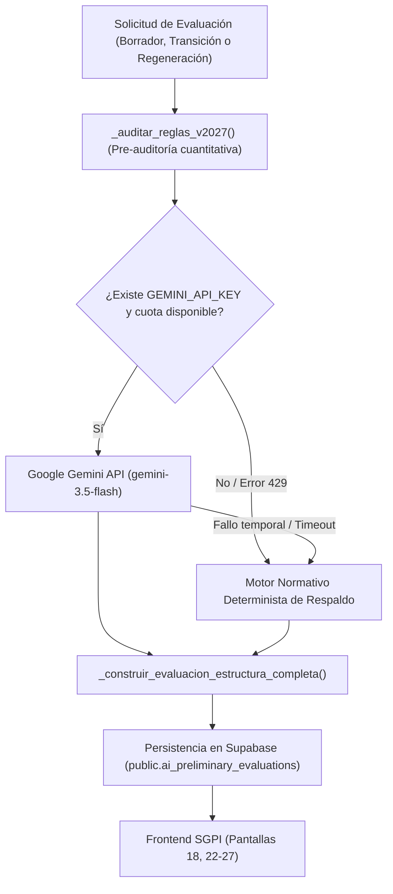
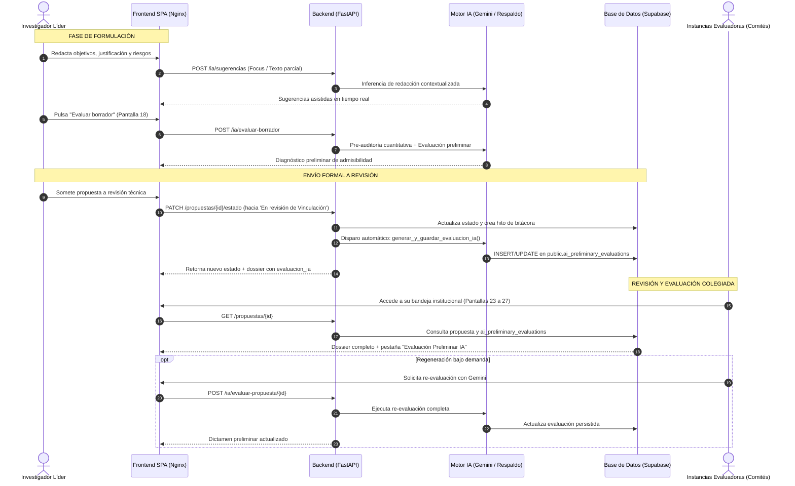

# 🤖 Manual Integral de Funcionamiento de la Inteligencia Artificial en SGPI
### Arquitectura, Ciclo de Ejecución, Modelo de Roles (RBAC) y Motor Normativo VIE 2027

---

## 📌 1. Introducción y Filosofía del Subsistema de IA

El Sistema de Gestión de Propuestas de Investigación (**SGPI**) del Instituto Tecnológico de Costa Rica (**TEC**) incorpora un subsistema de Inteligencia Artificial diseñado para acompañar el ciclo de vida completo de las iniciativas postuladas a la **Convocatoria Fondos VIE 2027** (Acuerdo Institucional `CIE-237-2026`).

El propósito central de la IA en este ecosistema no es reemplazar el criterio académico ni delegar decisiones colegiadas en algoritmos, sino actuar como un **órgano consultivo técnico preliminar y transversal**. Su meta es asistir al investigador durante la formulación de su propuesta y dotar a las instancias evaluadoras de una línea base objetiva, estandarizada y pre-auditada contra la reglamentación formal de la Vicerrectoría de Investigación y Extensión (VIE).

```
   ┌────────────────────────────────────────────────────────────────────────┐
   │                       FILOSOFÍA INSTITUCIONAL                          │
   │                                                                        │
   │  1. Carácter Referencial No Vinculante: La IA genera dictámenes y      │
   │     calificaciones orientativas. La soberanía evaluadora reside en     │
   │     los comités humanos (Comité Técnico, Consejos, Dirección, CIE).   │
   │                                                                        │
   │  2. Apego Estricto a la Norma: La evaluación refleja con exactitud la  │
   │     rúbrica ponderada institucional y las reglas de oro de Fondos VIE. │
   │                                                                        │
   │  3. Resiliencia Operativa: Arquitectura de Doble Motor que garantiza   │
   │     disponibilidad continua ante contingencias de conectividad o cuota.│
   └────────────────────────────────────────────────────────────────────────┘
```

---

## 🏗️ 2. Arquitectura Tecnológica y Doble Motor (Dual-Engine)

El subsistema de IA está implementado en el backend de FastAPI ([`backend/app/routers/ia.py`](file:///c:/DiseñoDeSoftware/SGPI/backend/app/routers/ia.py)) y opera bajo un esquema de **Doble Motor** que elimina los puntos únicos de fallo:



### 2.1. Motor Online: Google Gemini Free Tier
* **Proveedor**: Google AI Studio (Plan Gratuito).
* **Cadena de Modelos Prioritarios**:
  1. `gemini-3.5-flash` (*Modelo principal*: excelente balance entre razonamiento profundo, velocidad y compresión del contexto de convocatorias).
  2. `gemini-3.5-flash-lite` (*Primer respaldo de alta velocidad*).
  3. `gemini-3.1-flash-lite` (*Segundo respaldo gratuito*).
  4. `gemini-flash-lite-latest` (*Alias dinámico*).
* **Parámetros de Inferencia**:
  * `temperature: 0.2`: Mínima aleatoriedad para favorecer determinismo, consistencia en calificaciones de rúbrica y análisis riguroso de textos.
  * `responseMimeType: "application/json"`: Garantiza respuestas estrictamente tipadas y validables contra esquemas JSON.

### 2.2. Motor de Respaldo: Auditor Normativo Interno
Cuando no se encuentra configurada la variable `GEMINI_API_KEY`, o si la cuota gratuita de Google AI Studio (15 peticiones por minuto) se agota temporalmente (HTTP 429), el sistema **no interrumpe el flujo de trabajo**. Automáticamente conmuta a `modo_generacion: "motor_normativo_respaldo"`, el cual calcula con exactitud matemática:
* Ponderación sobre 100 de las 8 secciones de la rúbrica oficial.
* Detección de bloqueos por criterios obligatorios en escala $\{0, 6, 8, 10\}$.
* Auditoría de topes presupuestarios por modalidad y cuotas de horas/productos.

---

## 🔄 3. Ciclo de Ejecución de la IA en el Flujo Institucional

La IA interactúa en momentos clave del ciclo de vida de la propuesta, tanto de forma reactiva (a solicitud del usuario) como automática (activada por eventos de la máquina de estados).



### 3.1. Gatillo 1: Asistencia en Tiempo Real (`POST /ia/sugerencias`)
* **Ubicación**: Pantallas 14 a 18 (Asistente de Formulación paso a paso).
* **Comportamiento**: Cuando el investigador enfoca un campo o escribe texto parcial (por ejemplo, en el planteamiento del problema, objetivos específicos o matriz de riesgos), la IA analiza la escuela, modalidad y título ingresados para sugerir redacciones alineadas con la terminología científica institucional.

### 3.2. Gatillo 2: Evaluación Preliminar en Borrador (`POST /ia/evaluar-borrador`)
* **Ubicación**: Pantalla 18 (Revisión Final previa al envío).
* **Comportamiento**: Permite al investigador "probar" su expediente antes de someterlo formalmente. La IA evalúa la coherencia global, simula la rúbrica del Comité Técnico y alerta si existen riesgos de bloqueo normativo (ej. omisión de beca estudiantil o sobregiro presupuestario).

### 3.3. Gatillo 3: Disparo Automático por Transición de Estado
* **Ubicación**: [`backend/app/routers/propuestas.py`](file:///c:/DiseñoDeSoftware/SGPI/backend/app/routers/propuestas.py) en `PATCH /propuestas/{id_propuesta}/estado`.
* **Comportamiento**: En el momento exacto en que la propuesta transiciona de `En formulación` a `En revisión de Vinculación`:
  1. Se extrae el expediente integral desde PostgreSQL en Supabase (cabecera, equipo investigador, horas asignadas, presupuesto anualizado, actividades, riesgos, objetivos, productos académicos y declaraciones bioéticas).
  2. Se ejecuta la auditoría de reglas duras.
  3. Se genera la evaluación con Gemini y se persiste de forma atómica en `public.ai_preliminary_evaluations`.
  4. El expediente queda listo para que el Centro de Vinculación y los comités subsiguientes lo revisen con la evaluación ya adjunta.

### 3.4. Gatillo 4: Regeneración Bajo Demanda (`POST /ia/evaluar-propuesta/{id}`)
* **Ubicación**: Bandejas de evaluación (Pantallas 23 a 27).
* **Comportamiento**: Cualquier evaluador autorizado o el administrador del sistema puede forzar una re-evaluación en vivo si el expediente ha sufrido adendas o si se desea consultar una nueva corrida con el modelo en línea.

---

## 👥 4. Matriz de Permisos, Alcance y Facultades según Rol (RBAC)

La información producida por la IA se desagrega en 5 secciones especializadas dentro de la estructura de datos (`referencia_vinculacion`, `referencia_comite_tecnico`, `referencia_consejo_escuela`, `referencia_direccion_vie` y `referencia_cie`). Cada rol del sistema tiene permisos específicos sobre cómo interactúa con la IA:

| Rol Institucional | Pantalla Principal | Alcance de Visualización de la IA | Facultades de Ejecución de IA | Restricciones Específicas |
| :--- | :---: | :--- | :--- | :--- |
| **Investigador / Proponente** | Pantallas 14 a 18 y 22 | • Diagnóstico de su propio borrador.<br>• Resumen ejecutivo, fortalezas y alertas normativas de su propuesta.<br>• Puntaje preliminar orientativo. | • Solicitar sugerencias de campo (`/ia/sugerencias`).<br>• Evaluar borradores en memoria (`/ia/evaluar-borrador`). | • **No puede** dictaminar etapas oficiales.<br>• **No puede** ver expedientes ni evaluaciones preliminares de otros investigadores. |
| **Centro de Vinculación** | Pantalla 23 | • `referencia_vinculacion`.<br>• Potencial de activos de Propiedad Intelectual.<br>• Madurez tecnológica TRL inicial y meta sugerida.<br>• Alertas sobre reserva de confidencialidad previa a publicación. | • Consultar la evaluación preliminar.<br>• Disparar regeneración de IA bajo demanda. | • La IA sugiere dictamen técnico (*Favorable / Observaciones*), pero la decisión final la firma el gestor en su oficio oficial. |
| **Comité Técnico** | Pantalla 24 | • `referencia_comite_tecnico`.<br>• Calificaciones sugeridas para los 19 criterios de la rúbrica oficial (0, 6, 8, 10).<br>• Detección de bloqueos automáticos por criterios obligatorios insuficientes. | • Cargar criterios sugeridos por IA como borrador inicial de trabajo.<br>• Regenerar evaluación con Gemini. | • Las calificaciones sugeridas por la IA **no son vinculantes**: el evaluador debe validar y calificar cada criterio según su propio juicio. |
| **Consejo de Escuela** | Pantalla 25 | • `referencia_consejo_escuela`.<br>• Viabilidad y topes de horas semanales docentes (VIE, CONS, REC).<br>• Coherencia con líneas de investigación de la escuela.<br>• Aval presupuestario plurianual. | • Consultar dictamen preliminar como insumo de la sesión de consejo. | • El consejo emite o rechaza el aval institucional independientemente del puntaje numérico sugerido. |
| **Dirección de Investigación (VIE)** | Pantalla 26 | • `referencia_direccion_vie`.<br>• Verificación del checklist de admisibilidad de 5 puntos.<br>• Cumplimiento de beca para estudiante asistente especial.<br>• Coherencia de matriz de riesgos. | • Regenerar evaluación completa de cualquier expediente.<br>• Consultar diagnóstico y métricas globales de IA. | • Debe contrastar el checklist sugerido contra los registros de compromisos institucionales previos de los investigadores. |
| **Comité de Ética en Investigación (CIE)** | Pantalla 27 | • `referencia_cie`.<br>• Cumplimiento del debido proceso en instancias anteriores.<br>• Resumen ejecutivo y pertinencia bioética por los 4 ejes declarados. | • Consultar el dictamen consolidado para fundamentar la resolución colegiada. | • La emisión de acuerdos oficiales (Aprobado, Con condiciones, Rechazado) requiere votación de la asamblea colegiada. |
| **Administrador del Sistema** | Consola Admin | • Diagnóstico de salud (`GET /ia/estado`).<br>• Catálogo institucional de criterios (`GET /ia/criterios`).<br>• Monitoreo de consumos de tokens y fallback a respaldo. | • Habilitar/deshabilitar modelos de Gemini en variables de entorno.<br>• Ejecutar pruebas automatizadas integrales. | • No modifica evaluaciones persistidas directamente en BD sin auditoría. |

---

## ⚙️ 5. Funcionamiento a Fondo del Motor de Evaluación

### 5.1. Reglas Numéricas y Parámetros Pre-Auditados
Antes de enviar los datos al LLM, el sistema ejecuta validaciones deterministas sobre la base de las Disposiciones Oficiales VIE 2027:

1. **Topes Presupuestarios por Modalidad**:
   * *Actividad de fortalecimiento*: Máximo **₡2.000.000** en total (duración máxima 1 año).
   * *Investigación básica o aplicada*: Máximo **₡4.000.000 por año** (hasta 2 años).
   * *Desarrollo tecnológico*: Máximo **₡5.000.000 por año** (hasta 3 años).
2. **Restricción de Bienes Duraderos (Sección 2.3.9)**:
   * La partida de *Equipo y bienes duraderos* solo está permitida durante el **Año 1**. Si la propuesta programa equipamiento en años posteriores, se activa una alerta de no admisibilidad.
3. **Beca Estudiantil Obligatoria**:
   * Toda propuesta de investigación o desarrollo tecnológico debe incluir al menos una beca de *Estudiante Asistente Especial* (mínimo 10 horas semanales a ₡2.400/hora por 10 meses lectivos al año).
4. **Cargas Horarias Mínimas y Máximas**:
   * Mínimo institucional: $\ge 8\text{ horas/semana}$ totales del proyecto.
   * Mínimo por investigador: $\ge 4\text{ horas/semana}$ en tiempo VIE o CONS ($\ge 2\text{ horas/semana}$ si se financia por REC).
5. **Cuota de Productos Académicos**:
   * Investigación básica/aplicada: Al menos $\lceil \text{Horas Totales} / 10 \rceil$ productos académicos formalizados.
   * Desarrollo tecnológico: Al menos 1 activo protegido de Propiedad Intelectual (software registrado, patente, etc.) más los productos proporcionales a las horas.

### 5.2. Rúbrica Oficial de 8 Bloques y la "Regla de Oro"
El motor de IA califica los 19 criterios oficiales distribuidos en 8 bloques temáticos con pesos ponderados:

| Bloque de Rúbrica | Peso Relativo | Criterios Clave y Obligatoriedad |
| :--- | :---: | :--- |
| **1. Equipo de Investigación** | 15% | Composición disciplinaria (3%), Experiencia (3%), Articulación (3%), Vinculación externa (2%), Trayectoria (2%), **Participación estudiantil (2% — OBLIGATORIO)**. |
| **2. Fundamentación** | 12% | Definición del problema (4%), Coherencia de objetivos (4%), **Diagnóstico y vacío de conocimiento (4% — OBLIGATORIO)**. |
| **3. Metodología** | 15% | **Rigor metodológico (8% — OBLIGATORIO)**, **Validación con usuarios (7% — OBLIGATORIO)**. |
| **4. Plan de Acción** | 13% | **Claridad de actividades (4% — OBLIGATORIO)**, **Giras técnicas (4% — OBLIGATORIO)**, **Trazabilidad temporal (5% — OBLIGATORIO)**. |
| **5. Presupuesto** | 10% | **Coherencia y topes (4% — OBLIGATORIO)**, **Equipamiento en primer año (4% — OBLIGATORIO)**, Otros fondos (2%). |
| **6. Matriz de Riesgos** | 8% | **Identificación por actividad (4% — OBLIGATORIO)**, **Viabilidad de mitigación (4% — OBLIGATORIO)**. |
| **7. Bioética y Propiedad Intelectual** | 10% | **Declaración ética en los 4 ejes (4% — OBLIGATORIO)**, **Gestión de PI (6% — OBLIGATORIO)**. |
| **8. Pertinencia e Impacto** | 17% | Contribución socioeconómica (10%), Nivel de innovación (7%). |

```
   ┌────────────────────────────────────────────────────────────────────────┐
   │                  LA REGLA DE ORO INSTITUCIONAL VIE                     │
   │                                                                        │
   │  1. Umbral Cuantitativo: La propuesta requiere un puntaje total        │
   │     ponderado >= 70.0 / 100 para aspirar a ser recomendada.            │
   │                                                                        │
   │  2. Bloqueo Absoluto por Criterio Obligatorio:                         │
   │     Si CUALQUIERA de los criterios marcados como OBLIGATORIOS recibe   │
   │     calificación 0 (Deficiente) o 6 (Regular), la propuesta queda      │
   │     automáticamente clasificada como:                                  │
   │     «No recomendada (Bloqueo obligatorio)»                             │
   │     AUNQUE su puntaje final ponderado supere los 70 o los 85 puntos.   │
   └────────────────────────────────────────────────────────────────────────┘
```

---

## 💾 6. Modelo de Datos y Persistencia en Supabase

Los resultados de la IA se almacenan en la tabla relacional `public.ai_preliminary_evaluations` en PostgreSQL (Supabase Cloud):

```sql
CREATE TABLE public.ai_preliminary_evaluations (
    id_evaluacion_ia          INTEGER GENERATED BY DEFAULT AS IDENTITY PRIMARY KEY,
    id_propuesta              INTEGER NOT NULL UNIQUE REFERENCES public.propuestas(id_propuesta) ON DELETE CASCADE,
    modelo_ia                 VARCHAR(80) NOT NULL DEFAULT 'gemini-3.5-flash',
    modo_generacion           VARCHAR(40) NOT NULL DEFAULT 'gemini_online',
    puntaje_preliminar        NUMERIC(5,2) NOT NULL DEFAULT 0,
    recomendacion_global      VARCHAR(60) NOT NULL,
    tiene_bloqueo_obligatorio BOOLEAN NOT NULL DEFAULT false,
    resumen_ejecutivo         TEXT NOT NULL,
    referencia_vinculacion    JSONB NOT NULL DEFAULT '{}'::jsonb,
    referencia_comite_tecnico JSONB NOT NULL DEFAULT '{}'::jsonb,
    referencia_consejo_escuela JSONB NOT NULL DEFAULT '{}'::jsonb,
    referencia_direccion_vie  JSONB NOT NULL DEFAULT '{}'::jsonb,
    referencia_cie            JSONB NOT NULL DEFAULT '{}'::jsonb,
    fortalezas                JSONB NOT NULL DEFAULT '[]'::jsonb,
    alertas_normativas        JSONB NOT NULL DEFAULT '[]'::jsonb,
    criterios_sugeridos       JSONB NOT NULL DEFAULT '{}'::jsonb,
    fecha_generacion          TIMESTAMP WITHOUT TIME ZONE NOT NULL DEFAULT clock_timestamp()
);
```

### 6.1. Idempotencia y Eficiencia
* Las inserciones y actualizaciones utilizan `ON CONFLICT (id_propuesta) DO UPDATE`, garantizando que cada propuesta mantenga únicamente su evaluación preliminar más reciente y evitando registros huérfanos.
* En `backend/app/routers/ia.py`, la función `_extraer_expediente_para_ia()` utiliza el modo **pipeline** de `psycopg 3` para ejecutar las 8 consultas de extracción en un único viaje de red (*single round-trip*) hacia Supabase Cloud en Oregon, minimizando la latencia.

---

## 🛡️ 7. Seguridad, Saneamiento y Manejo de Errores

1. **Aislamiento de API Keys**:
   * Las credenciales de Google Gemini (`GEMINI_API_KEY`) residen exclusivamente en variables de entorno seguras del servidor (Render o `.env` local). Nunca se exponen al navegador cliente ni en el código fuente.
2. **Defensa contra Inyecciones SQL**:
   * Todas las consultas que alimentan el contexto de la IA utilizan parámetros posicionales (`%s`) mediante `psycopg`. Además, el middleware global `sql_injection_guard` inspecciona parámetros entrantes para bloquear cualquier patrón malicioso antes de alcanzar la lógica de la IA.
3. **Resiliencia ante Límites de Tasa (Rate Limiting HTTP 429)**:
   * Si la cuota gratuita de Google AI Studio se colapsa durante demostraciones o evaluaciones masivas, el bloque de excepción en `_invocar_gemini_online_free_tier()` captura el código HTTP 429 o `URLError` y transfiere la petición de forma instantánea y transparente al motor normativo determinista, devolviendo un dictamen completo con `modo_generacion: "motor_normativo_respaldo"`.
4. **Validación de Tipos de Salida**:
   * Toda salida generada por Gemini es saneada mediante `_limpiar_bloque_json()`, extrayendo los delimitadores ` ```json ` y asegurando que las calificaciones sugeridas pertenezcan únicamente al conjunto $\{0, 6, 8, 10\}$ antes de persistir o calcular promedios ponderados.
